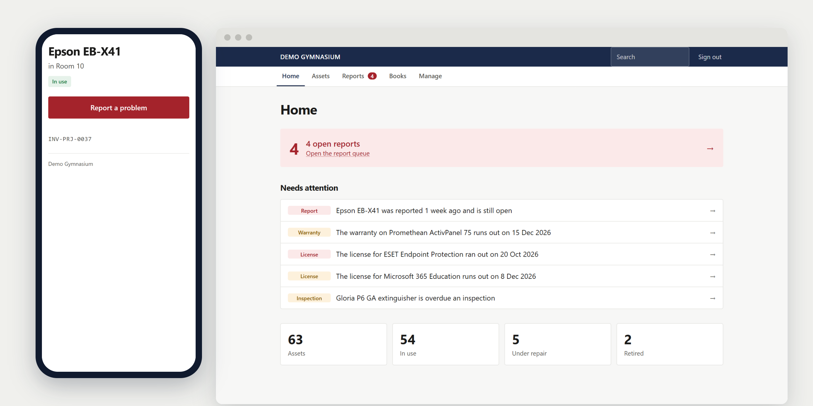
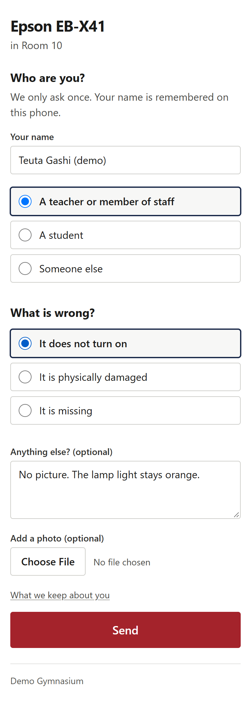
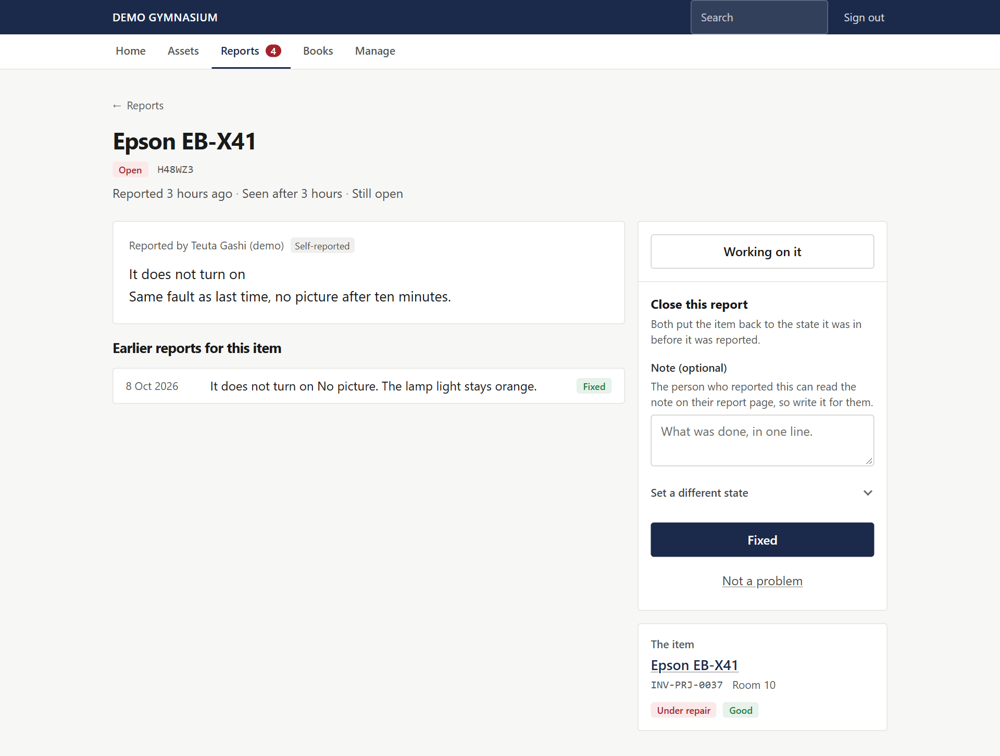
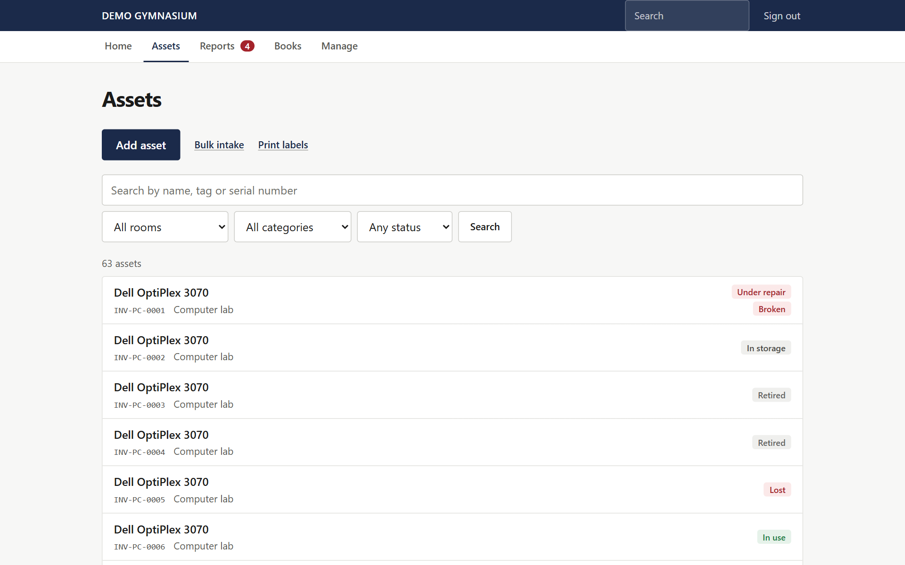
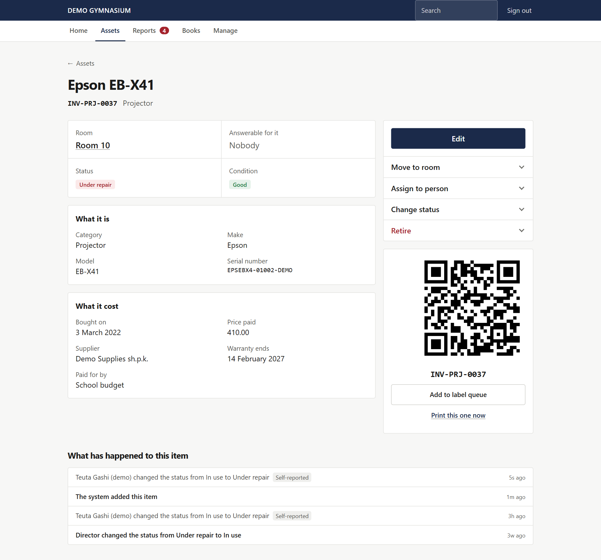
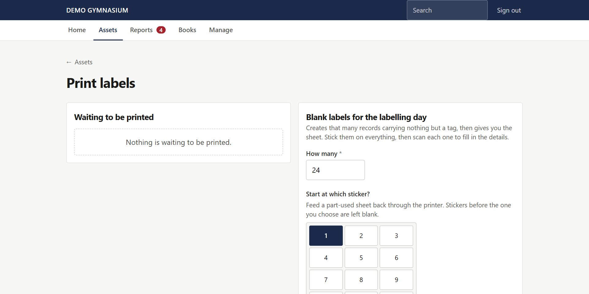
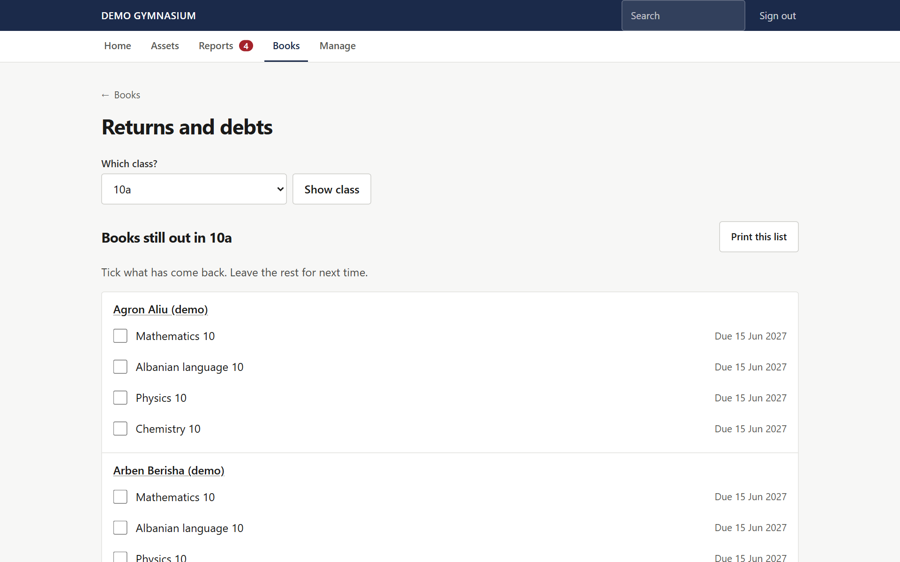
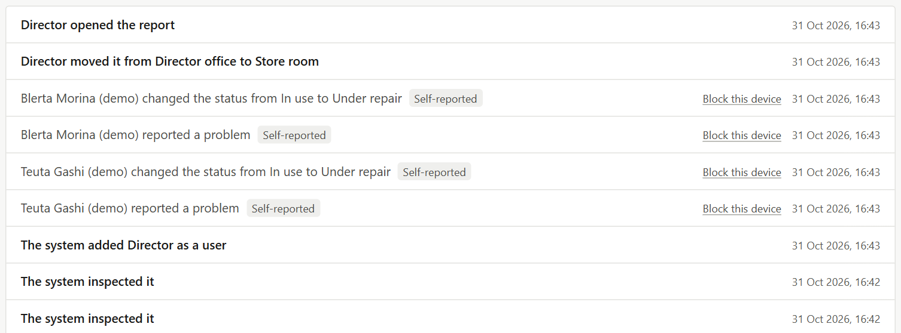

<p align="center">
  
</p>

# School Inventory

**Point a phone at a sticker, say what's broken, and the director knows.** Inventory, fault reporting, inspections and textbook loans for a small school, built around the people who actually notice problems: teachers with no account, an old phone and a minute between lessons.

[](https://github.com/mirzamemovic/school-inventory/actions/workflows/tests.yml)


My internship project for a small private gymnasium in Kosovo: about 100 students, 20 staff, 120 labelled assets and 800 textbooks. I took it from specification to a tested, documented system.

| | |
|---|---|
| **Stack** | Laravel 13, Blade, HTMX, Tailwind, MySQL, Pest, Docker for the demo |
| **Size** | 125 routes, 22 migrations, 52 audited action types |
| **Tests** | 466 tests, run on SQLite and MySQL 8 in CI |
| **Try it** | [One Docker command](#run-it), with fictional data |

## The hard part

The screens in an inventory app are easy. A school is hard because of who uses it and where it runs.

| The constraint | What it forced |
|---|---|
| **Teachers will not log in.** Twenty accounts for something they touch four times a year means forgotten passwords, and then nobody opens it. | Reporting is a public page with no account, which makes it an unauthenticated write endpoint. Most of the security work follows from this one decision. |
| **The likeliest attacker is a bored teenager standing next to the sticker.** They already have the link, and tags are sequential. | Every public action is designed around what a stranger could do with it ([the rule below](#the-rule-behind-every-public-page)). |
| **The database holds children's names.** Kosovo's Law No. 06/L-082 transposes the GDPR and covers private schools. | Written retention rules, a confirmation step before anything is deleted, and erasure that removes a person without breaking the audit log. |
| **Hosting is shared cPanel,** possibly with no SSH or Composer on the server. | Server-rendered Blade with HTMX, no Node in production, no queue worker to keep alive, and admin accounts managed in the browser. |
| **The real user is a teacher in their fifties with a cracked Android** on weak school wifi. | No app to install, no web fonts, 44px tap targets, layouts down to 320px, and colour used only for status, always with a word. |

## What it makes easier at school

| Today, on paper | With this system |
|---|---|
| A projector breaks. The teacher means to tell someone, forgets by the afternoon, and the next teacher finds it broken too. | Scan the sticker, tap what's wrong, send. The target is under 30 seconds, with no app and no login. |
| Five people report the same fault, or nobody does because they assume someone else has. | The next person to scan sees *"Reported 1 week ago — being looked at"*, and the button changes to *Add more information*. |
| Nobody knows whether the director has seen a report. | Each report tracks when it was seen, not only when it was closed: *"Reported 3 hours ago · Seen after 3 hours · Still open"*. Anything open for over a week turns red. |
| The same projector fails for the third time and it still gets treated as a one-off. | The item's earlier reports sit on the same page as the new one, so the director can see when to replace rather than repair. |
| Nobody can say how many laptops there are, which room they're in or who took one home. | Every item has a room and, separately, a person answerable for it. Printable room sheets support the annual count, and 500 chairs are counted per room instead of labelled. |
| Hundreds of books go out in September and get chased by hand in June. | Issue to a whole class on one screen. In June, tick off returns by class, print the list, or send the class teacher a signed read-only link over WhatsApp. |
| Fire extinguisher checks live in someone's head. | Each one has an inspection schedule. Overdue checks appear on Home, and a failed check raises a report by itself. |
| A licence lapses, and nobody remembers which email account owns it. | Licences are listed by expiry with the owning account recorded. The warning differs for *the service stops* and *money leaves the account*. |
| Labelling everything would take days of typing. | Print blank labels first and stick them on. Then scan each one, fill in four fields and tap *Save and scan next*. It goes straight to the next label, never back to a list. |

<p align="center">
  
  &nbsp;
  
</p>

## The rule behind every public page

> **Anonymous input may raise a warning. It must never silence one.**

Nobody on a public page can be verified, since that's the whole point of having no login. So instead of trying to verify them, each action is shaped so that the worst a stranger can do is add noise the director can see.

| Public action | What a teenager would try | Why it fails |
|---|---|---|
| Report a problem | Send joke reports | They show up in the queue, *Not a problem* restores the item, and the device can be blocked from the log |
| Recount the supply cupboard | Set paper to 9999, so the low-stock warning never fires again | The public page can confirm or lower stock but never raise it |
| "Checked, it is fine" on an extinguisher | Reset the overdue clock on a record with legal weight | It only counts from a phone the director enrolled in person. Other taps are recorded but don't move the date |

Other decisions you can check in the code:

- **Tags stay sequential on purpose,** because someone has to be able to read a scratched sticker aloud. So anyone can walk the URLs, and the defence is what the page exposes: it's built from [`PublicAssetView`](app/Support/PublicAssetView.php), which has no price, serial or warranty field to leak.
- **Rate limits go by device first, IP second,** because the whole school shares one public address and the tenth teacher on a Monday must not be blocked.
- **The public report form builds its record field by field,** so `status` or `resolved_at` can't be mass-assigned from a request.
- **Uploaded photos** are checked by content, sized before decoding, re-encoded to strip GPS data, renamed at random and stored outside the web root.
- **A strict Content-Security-Policy** runs only the site's own scripts, and a test fails if an inline handler ever appears in a view.

The full reasoning, including the risks accepted on purpose, is in [SECURITY.md](docs/SECURITY.md).

## Decisions I'd defend in an interview

- **Status and condition are separate fields.** A working laptop in a cupboard is *In storage* and *Good*. A report snapshots both, and closing it restores them, but only if the item is still under repair, so a stale snapshot can't overwrite something newer.
- **Three buttons instead of a status dropdown.** *Working on it*, *Fixed* and *Not a problem* are the only actions, and the system works out the rest.
- **The QR code is never stored.** It's drawn on demand from the tag, so there's no file to lose and no job to fail. A tag is write-once, because the sticker can't change.
- **Sticker addresses come from `APP_URL`, not the request.** One print run from a temporary address would otherwise put the wrong URL on every sticker for good.
- **One append-only audit log, and it stays honest.** Admin actions are shown as solid, and public ones are tagged *Self-reported* because nobody verified them. Erasure pseudonymises the rows and scrubs names from the JSON too, so the equipment's history survives without the person.
- **What I refused to build.** Roles, a permissions matrix, a notification centre and charts. Two admins and one rule cover this school, and scope was the biggest risk to the project.

## Bugs worth talking about

Tests passing was never the end of the job. These came from going back through the system and trying to break it.

- **A green test suite hid real data corruption.** On the first MySQL-family run every test passed, but probing found that erasing a person silently rewrote the dates of their safety inspections. Older servers auto-update the first `timestamp` column in a table, and SQLite can't show that. The same columns would also have failed for checks due after January 2038. CI now runs on MySQL 8 as well.
- **An 80-byte PNG could take the report form down.** It declared 20,000 × 20,000 pixels, passed validation and exhausted memory when GD allocated the canvas. Dimensions are now checked before decoding.
- **A stale browser tab could undo a repair.** A second *Fixed* re-applied an old snapshot even if a new fault had been reported since. Closing now acts only on an open report, under a row lock, in one transaction.
- **A name could run as a formula in Excel.** Names typed on public pages went into the CSV export unescaped, and the director opens that file in Excel. Every cell is now neutralised.
- **A leaked class link couldn't be withdrawn.** The same class always signed to the same URL, so "regenerate" handed back the leaked link. Each class now has a version inside the signature.

## How I built it

I used AI coding tools throughout, and I ran them the way a lead runs a capable team: they moved fast, and I stayed responsible for what shipped.

- **I set the direction.** The work started from a [written specification](docs/SPECIFICATION.md): threat model, data model, build order and a list of things not to build.
- **I kept the decisions.** Product rules, security trade-offs and what to refuse stayed with me. "Recount can never raise stock" is a decision about how a school works, and a tool can't make it for you.
- **I checked the work rather than trusting it.** Every write path needs a test. Audits against the spec found the [bugs above](#bugs-worth-talking-about), and changes land as small, reviewable commits.

That let me deliver far more than I could have alone in the time, without giving up understanding of the code. Ask me about any part of it.

## More screens

| | |
|---|---|
|  |  |
| **Assets:** status is always a word as well as a colour | **One item:** where it is, what state it's in, its QR and its whole history |
|  |  |
| **Labels:** start at any cell, so a part-used sticker sheet isn't wasted | **Books:** tick returns by class, or print the list |



The audit log reads as sentences, and self-declared actions are marked as such.

## Run it

**With Docker** (the quickest way, with fictional data that resets on restart):

```bash
git clone https://github.com/mirzamemovic/school-inventory.git
cd school-inventory
docker build -t school-inventory .
docker run --rm -p 8080:8080 -e APP_ENV=local -e APP_URL=http://localhost:8080 -e DEMO_ADMIN_EMAIL=you@example.com -e DEMO_ADMIN_PASSWORD="plum ladder orbit kettle" school-inventory
```

- Scan page, no login: <http://localhost:8080/a/INV-PRJ-0037>
- Director's side: <http://localhost:8080/login>, with the email and password above

**Without Docker** (PHP 8.3+, Composer, Node 22+):

```bash
composer run setup
php artisan db:seed
php artisan db:seed --class=DemoSeeder
php artisan user:create "Your Name" you@example.com
php artisan serve
```

**Tests:**

```bash
php artisan test
```

## Documentation

| Document | What's in it |
|---|---|
| [SPECIFICATION.md](docs/SPECIFICATION.md) | The original brief, including what not to build and why |
| [ARCHITECTURE.md](docs/ARCHITECTURE.md) | Tables, routes, invariants and known gaps |
| [SECURITY.md](docs/SECURITY.md) | Threat model, controls and what's accepted on purpose |
| [RETENTION.md](docs/RETENTION.md) | Data retention and erasure rules |
| [DEPLOYMENT.md](docs/DEPLOYMENT.md) | Shared-hosting deployment, backups and checks |
| [UI-AUDIT.md](docs/UI-AUDIT.md) | Accessibility and mobile findings, and open workflow questions |

## Status and known gaps

The system is finished and handed over, and the school hasn't deployed it yet, so it has no production usage to report. The main gaps are written down rather than hidden:

- The September CSV import needs Excel's "CSV UTF-8" format, and it should convert or refuse anything else before the first real import.
- CSV export covers the activity log, but assets, book debts and licences are still to do.
- Notifications are in-app only. `ReportCreated` already fires, so email can be added as a listener.
- The interface is English. Every string is in translation files, ready for Albanian.

The full list is in [ARCHITECTURE.md](docs/ARCHITECTURE.md#15-known-gaps-and-open-questions).

## Author

**Mirza Memovic** · [github.com/mirzamemovic](https://github.com/mirzamemovic)

The code is published for review. See [LICENSE](LICENSE).
